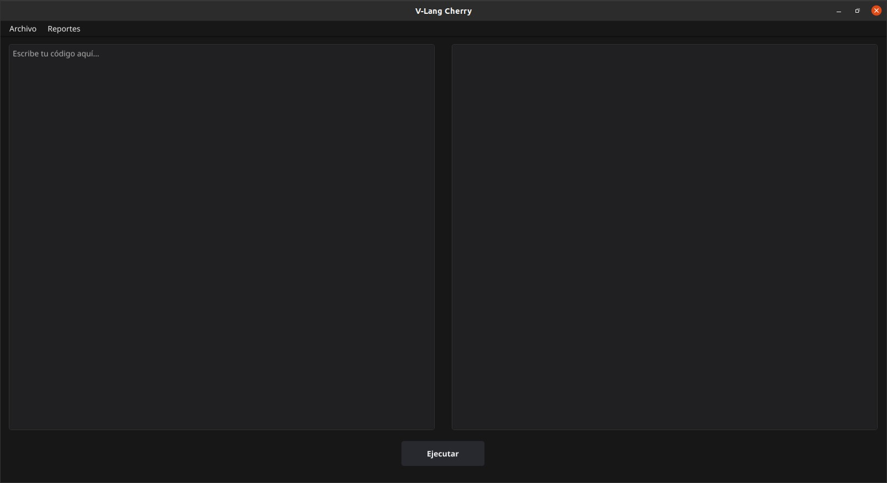

# Manual de usuario
El intérprete V-lang Cherry es una aplicación que procesa archivos de código fuente (.vlang) ejecutando programas escritos en este lenguaje ligero y eficiente. Al recibir un archivo de entrada, el intérprete realiza automáticamente el análisis léxico, sintáctico y semántico, mostrando los resultados de ejecución en la consola. La herramienta incluye un sistema detallado de manejo de errores que indica problemas con precisión (línea y tipo de error), y ofrece opcionalmente una interfaz gráfica con editor integrado para una experiencia más interactiva de edición y ejecución de código. Diseñado para ser rápido y liviano, es ideal tanto para aprendizaje como para desarrollo en entornos con recursos limitados.

La interfaz gráfica de V-Lang Cherry está diseñada como un entorno de desarrollo integrado (IDE) minimalista pero funcional, compuesto por tres áreas principales:

### Editor de Código (Área Superior):

- Zona interactiva donde los usuarios escriben o pegan su código V-Lang

- Implementa resaltado de sintaxis en tiempo real para mejor legibilidad

- oporta autocompletado básico de palabras clave del lenguaje

- Muestra números de línea para referencia rápida

### Consola de Salida (Área Inferior):

- Muestra resultados de ejecución del programa

- Presenta mensajes de error detallados con ubicación exacta (línea y columna)

### Flujo de Trabajo:

- El usuario escribe código en el área designada

- Al activar la ejecución (mediante botón o comando):

- El contenido se envía al intérprete backend

- Se realiza análisis léxico/sintáctico

- Se ejecutan las instrucciones válidas

- Los resultados/errores se muestran en la consola inferior

### Reportes
En la sección de reportes se muetra:
- Reporte de errores: 
Se muestran todos los errores que se encuentren durante el proceso de compilación. 

- Reporte de tabla de símbolos: Este reporte muestra la tabla de símbolos después de la ejecución del archivo. 

- Reporte de AST: Este reporte muestra el Árbol de Sintaxis Abstracta (AST) generado a partir del código de entrada.

